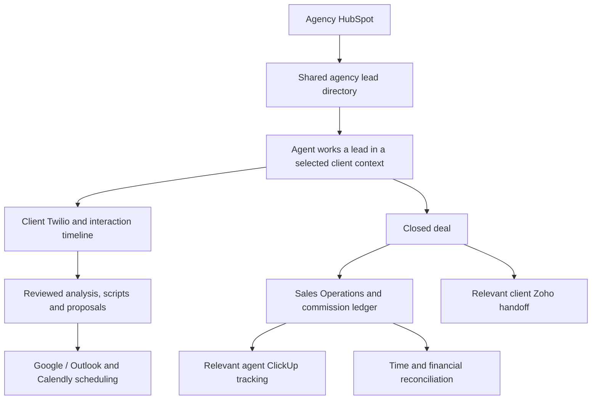

# Alignment audit: modules 6.1–6.9

Audited 2026-10-01 against [PROJECT_REQUIREMENTS.md](PROJECT_REQUIREMENTS.md).

## Unused code cleanup, 2026-10-07

Branch `codex/unused-code-cleanup` preserves the current application changes in snapshot commit `09701cb` before cleanup. The original `codex/auth-validation-integration` ref, protected `new`, `ai-ui-backend`, and deferred `email-setup` refs remain unchanged. No branches were deleted or pushed.

Verified current TypeScript imports and application route reachability, then checked candidates against source and scripts. The existing Graphify graph is stale (built at `f86eab2e`) and was only used as historical context. Removed eight unreferenced preview/visual components, the obsolete development bootstrap seeder, and the spatial context/configuration after confirming there are no consumers of `useSpatial`. Removing the spatial provider also removes its otherwise unused continuous animation-frame state updates. Removed 33 unused imports and unused tab/client-permission state. Removed six unused direct dependencies (`three`, `@types/three`, `framer-motion`, `recharts`, `clsx`, `tailwind-merge`) and regenerated the npm lockfile without upgrading retained packages intentionally.

Retained active pages/API routes, authentication and email delivery, all required provider implementations, database migrations/models, manual workflows, tests, and requirements documentation. Legacy ActiveCampaign code remains compatible with existing records as required. No production database data or live provider records were changed by cleanup.

Validation: production build (including TypeScript and route generation), authentication credential tests, merged authentication integration tests, and dashboard/ClickUp regression tests passed. Integration tests use disposable PostgreSQL fixtures and intercept provider calls; no live email or ClickUp operations occurred. Full-source lint was used to locate unused imports; existing unrelated lint errors (including `any` types) remain, so repository-wide lint is not certified clean.

## Agent home and ClickUp reporting, 2026-10-07

Implemented on `codex/auth-validation-integration` following the live [persistence audit](docs/database-persistence-audit.md). Agent home now uses an authenticated, read-only PostgreSQL overview for company-owned HubSpot directory counts, the agent's recorded outbound calls today (UTC), saved analyses and closed deals, assigned-client CRM connections, personal calendar connections/upcoming appointments and recent personal interactions. Metrics/activity span currently assigned clients; agency directory totals remain shared across client switching. A pending agent gets an assignment waiting state. Credentials are excluded; refresh does not trigger provider sync. Preview CRM creation/sync controls are replaced with real module navigation. The user explicitly excluded Multi-CRM's Sync Clusters; it remains unchanged.

Sales Operations now uses the existing single/batch ClickUp endpoints, recognizes persisted `SYNCED` status, and displays actual batch success/failure counts. A post-sync refresh error no longer overwrites the confirmed sync result. Server sync verifies active agent, deal ownership, tenant, closed-won status and client assignment before writes. Acknowledged provider success followed by a local confirmation failure retains the returned task ID in recovery state where that write succeeds, distinguishes this from provider failure, and subsequent retry updates the mapped task. Batch processing retains earlier success results if a later deal throws. This does not solve every network-ambiguity/concurrent-worker duplicate scenario; no live ClickUp sync was triggered to certify provider behavior.

Validation: `node scripts/dashboard-clickup-test.cjs` covers PostgreSQL dashboard totals/scope, pending account, endpoints, status contract, batch counts, forbidden deals, repeat updates and provider-success/local-write-failure recovery with intercepted provider calls. The nine commission reconciliation checks, TypeScript, targeted lint for the new dashboard/API files and production build passed. Browser review with disposable fixtures verified live home counts and the Synced task link; fixtures were removed afterward. No schema migration was required.

## UI and AI integration, 2026-10-04

`codex/ui-ai-backend-integration` combines the release branch's UI/Gemini work with `codex/consolidated-modules`; see [integration notes](docs/ui-ai-backend-integration.md). PostgreSQL/Prisma, CRM ownership, commissions/reconciliation, active tracking, live calendar services and Twilio callbacks are retained. Gemini lead analysis now records its actual provider; unavailable or invalid generation falls back to clearly labeled rule-based analysis. A migration adds the Gemini provider enum without replacing data. Live provider verification remains separate from controlled automated checks.

## Implementation progress: first safety batch

Implemented on `codex/crm-boundary-safety`, created from `twilio+calendly` at `e4ad0b4`. The user-protected `new` branch remains at `e4ad0b4`; `email-setup` remains separate at `e90634c`. No merge, auth implementation, schema change, migration, or live CRM write was performed.

- Client CRM listing is read-only for both empty and populated lists. Explicit provider imports no longer run fuzzy mirroring or delete saved records. Imported records keep verified connection/provider/record provenance; unrelated and manually maintained rows are preserved.
- Handoff creation, dispatch, and retry authorize the actual target client before mutation or provider calls. Mutations require the selected client to match. Requested-client overrides on contact/handoff reads also check assignments. Agency directory reads now filter both contacts and displayed provenance to company-owned HubSpot mappings.
- The current client CRM screen and list APIs show Zoho records/handoffs; Sync and new-handoff APIs require client-owned Zoho. Missing Zoho does not select another integration. Legacy records/code are retained, and internal compatibility paths remain isolated. An existing handoff cannot be relabeled as a different CRM destination.
- Client edits persist locally without email-based writeback to agency leads. Remote edits require a verified destination mapping and supported record type. The response and UI distinguish completed, failed, unmapped, disconnected, and unsupported results; a failed remote edit retains its previous successful-sync timestamp.
- Live Zoho/legacy import failures and empty responses no longer become demo data. Zoho writes require per-record success and a returned destination ID; a mapped update must return the same ID. A rejected contact/note operation makes its handoff fail. Already-successful handoffs do not resend. This follows the provider's [write-result contract](https://www.zoho.com/crm/developer/docs/api/v3/update-records.html).

Verification: **47 isolated service/route/provider-response regression tests passed**, including unauthorized targets, saved-record preservation, Zoho-only current APIs with legacy records present, correct routing, failed-result handling, and repeated successful handoffs. TypeScript and targeted lint for changed services/routes/the new harness passed. The production build passed. The client page has a pre-existing `react-hooks/set-state-in-effect` lint error and unused-import warnings; comparing baseline/current lint messages confirmed this patch did not add to them. Full-project lint is not claimed passing.

Run the isolated checks with `npm run test:crm-safety` (or `node --test --test-reporter=dot scripts/crm-boundary-safety-test.cjs`). Existing stage 2.7/2.8 database test assertions were updated for explicit import and legacy routing, but those database-mutating suites were not run. Provider calls in the new tests use controlled responses, not live credentials; live compatibility still requires provider acceptance testing.

Stage 1's safety gates are addressed; the nine modules are still incomplete. The next batch is stage 2: separate agency lead identity from selected-client work context across dependent modules. Full partial-failure/crash-safe retries, durable sync operations, field conflict policy, and provider pagination remain later work. In particular, a failed handoff after a remote contact/deal creation can still create duplicates on retry; suppressing repeats of an already-successful handoff does not solve partial-success recovery.

The audit below is the historical `e4ad0b4` snapshot. Its source line numbers and defects describe that baseline; use this progress section and current source to identify what has since been corrected.

## Scope and confidence

- Checkout: `twilio+calendly`, HEAD `e4ad0b4` (`agent cem clickup`). The worktree was clean before this documentation task.
- Method: inspect existing Graphify relationships, then verify relevant pages, API routes, services, Prisma models, provider adapters, and test assertions in current source. The existing graph is a locator, not proof of feature completion: its report predates this HEAD. No graph rebuild was performed.
- This is a source audit. No database-mutating system tests or live provider calls were run. An implemented HTTP adapter is not a verified live integration.
- The original audit recorded requirements, findings, and acceptance gates without implementing fixes. Subsequent implementation is recorded above.

The project has substantial persisted manual workflows and real HubSpot/Zoho/ClickUp adapter code. Every required module is **PARTIALLY IMPLEMENTED** as a whole: its manual or local foundation exists, but its required automation, provider coverage, or consistency is unfinished. Several foundation defects must be corrected before connecting the modules into the required workflow.

## Required architecture

This diagram is the target workflow, not a claim that all arrows are implemented. Switching clients changes the working client, Zoho, Twilio, and scheduling context while preserving the same agency HubSpot directory and the agent's own ClickUp connection. ActiveCampaign remains legacy code, not the planned client CRM. The user confirmed Google/Outlook **plus** Calendly.

## Baseline discrepancy: previous work is on another branch

The current checkout still rejects agent signup, asks administrators to create agent credentials, and displays agent email. See [auth-service.ts](src/lib/auth/auth-service.ts), lines 69–71; [signup/page.tsx](<src/app/(auth)/signup/page.tsx>), line 65; [admin-service.ts](src/lib/admin/admin-service.ts), lines 144–176; and [AdminWorkspacePage.tsx](src/components/admin/AdminWorkspacePage.tsx), lines 210–238.

The earlier signup/verification/Google OAuth implementation and architecture documents exist on `email-setup`, commit `e90634c` (`email+google oauth`). Read-only Git inspection found the email verification and Google routes, enrollment service, auth migration/test, `AUTH_SETUP.md`, `CURRENT_ARCHITECTURE.md`, and `NEXT_CODEX_HANDOFF.md` there. These are absent from this checkout. Their existence in that branch is not proof of live email delivery or Google configuration.

The user clarified on 2026-10-01 that `email-setup` must remain separate until the end, after mail credentials are ready. Continue from `twilio+calendly` or focused branches derived from it. Do not merge/cherry-pick the auth feature early or duplicate it here. Its absence does not block the other module fixes; preserve request-context compatibility and review the deferred integration at the end. Do not infer completion from branch names: Calendly is absent from this branch's application source, schema, and scripts despite the branch name.

Required auth acceptance remains: independent agent and admin signup; emailed verification code and confirmation for email/password signup, plus Google authentication; a pending agent has no agency/client access; an administrator finds and approves the agent by **name plus a safe account reference**, without agent email appearing in admin UI/API responses; assignments grant only permitted client access.

## Module status at a glance

| ID | Working foundation in this checkout | Missing or incorrect requirement coverage |
| --- | --- | --- |
| 6.1 Sync | HubSpot imports and mapped edits, Zoho read/write and handoff, ClickUp closed-sale tracking, manual retries/history | Agency/client scope conflicts; mismatched provider IDs; unsafe target fallback; no durable cross-provider convergence/conflict policy; no file import fallback |
| 6.2 Identity | Client-scoped identity selector; outbound Twilio REST call/SMS code; manual launch/logging | Client-owned credentials and usable identity provisioning; agent audio path; inbound/status callbacks; truthful delivery/identity state; fallback fails when identity is absent |
| 6.3 Timeline | Persisted manual notes/calls/SMS/email summaries, imported/deduplicated HubSpot activities, outgoing gateway logs | Incoming communications and complete email ingestion; pagination and complete cross-source/event deduplication; actual sync health; original occurrence time and complete metadata |
| 6.4 Analysis | Pasted transcript/body, persisted qualification fields, rules-based score, audited manual corrections | Real model extraction/scoring, transcript file intake, automatic call transcription, approved CRM field application and sync |
| 6.5 Scripts | Fixed contextual call/SMS/email templates; full manual create/edit/save | Real generation using conversation history and client commercial facts |
| 6.6 Finance | Manual closed sales, commission ledger/payments, rate defaults, deal snapshots, ClickUp tracking | CRM closures are disconnected from payout ledger; inconsistent/concurrent updates; currency and truncated-total defects |
| 6.7 Reconciliation | Manual time entries/corrections, billable-hours display, loaded commission CSV | Automatic account time, complete time/financial reports, full-range exports, timezone correction |
| 6.8 Scheduling | Local manual appointments, edits/cancellation, keyword suggestions, mock adapter | Google/Outlook and Calendly adapters; external availability/invitations/rescheduling; actual AI intent/time extraction |
| 6.9 Documents | Editable template proposals/follow-up drafts, draft/final status, PDF upload/download | Generative drafting grounded in call outcomes and validated extracted fields |

## Foundation defects to resolve first

### 1. Shared agency leads are still stored with selected-client ownership

`Contact.clientAccountId` is mandatory in [schema.prisma](prisma/schema.prisma), lines 475–490. Company-owned HubSpot imports set it to `context.activeClientAccountId` in [contact-sync-service.ts](src/lib/sync/contact-sync-service.ts), lines 163–171. The external mapping is unique by connection/object/external ID, so later imports in another client context retain that original attribution. HubSpot company/deal/activity imports also carry active-client context; see [hubspot-sales-sync-service.ts](src/lib/sync/hubspot-sales-sync-service.ts), line 229.

Meanwhile, agency-directory queries retrieve organization-wide contacts and choose their latest provider mapping without constraining provenance to agency HubSpot ([contact-sync-service.ts](src/lib/sync/contact-sync-service.ts), lines 558–601). Client-origin contacts can therefore enter the shared directory. The lead-page import only searches client-owned connections (lines 193–195), missing a company-owned HubSpot connection.

AI, scripts, documents, and scheduling reject a contact whose `clientAccountId` differs from the selected client. This prevents the required flow of working the same agency lead for another assigned client. Relevant checks: [lead-analysis-service.ts](src/lib/ai/lead-analysis-service.ts), line 43; [sales-script-service.ts](src/lib/scripts/sales-script-service.ts), line 26; [document-service.ts](src/lib/documents/document-service.ts), line 22; [calendar-service.ts](src/lib/calendar/calendar-service.ts), line 48.

**Required correction:** separate agency lead identity/provenance from authorized client work context. Retain distinct client-owned records and provider mappings. A lead should not be duplicated or reassigned merely because the agent switches clients. Explicitly associate a deal/work session with its intended client.

### 2. Reading the client CRM deletes local records and infers routing

[client-crm-service.ts](src/lib/client-crm/client-crm-service.ts), line 299, invokes mirroring during `listClientCrmRecords`. The mirror deletes **all local COMPANY records** for that client at line 42, then purges CONTACT/DEAL records outside inferred matches at lines 257 and 267. These operations change the platform database; they are not remote Zoho deletions. Even so, merely opening the page can remove imported or manually maintained local client records. Client matching is based partly on company/brand similarity rather than an explicit reviewed handoff.

**Required correction:** listing must not perform destructive cleanup. Preserve imported/manual records and provenance; make controlled handoff/sync an explicit, authorized operation. Limit any later cleanup to records the relevant sync operation owns.

### 3. Provider target and identifier boundaries are unsafe

The client CRM selects any client connection when Zoho/ActiveCampaign are absent and calls ActiveCampaign for every non-Zoho provider ([client-crm-service.ts](src/lib/client-crm/client-crm-service.ts), lines 577–597). Handoff has equivalent fallback ([handoff-service.ts](src/lib/handoff/handoff-service.ts), lines 238–312). A future Twilio/calendar connection must never be treated as a CRM connection.

Mirroring also stores an agency external ID under a client connection (client CRM lines 89–91 and 136–143), then may pass it to a Zoho edit path (lines 455–499). A HubSpot contact ID is not a Zoho record ID.

Further source review during implementation planning found that [zoho/client.ts](src/lib/integrations/zoho/client.ts), lines 319–323, trusts the first result without checking per-record success and falls back to `Date.now()` as an external ID. Its handoff calls create/update without destination IDs for contact, deal, and note (lines 360, 391, 416). Consequently, live retries can issue new creates even though the local handoff row is unique and the function comment says idempotent. This is a source-level risk; no live duplicates were generated during the audit.

**Required correction:** select providers by explicit role and ownership; maintain separate destination IDs; validate provider result success and returned IDs; fail with a useful configuration state when the intended provider is missing. Reuse trusted saved destination IDs/operation identities on handoff retries and preserve partial-success state. Keep legacy ActiveCampaign routes explicit and isolated.

### 4. Handoff authorizes the active client but not every requested target

Handoff creation looks up a deal by organization only ([handoff-service.ts](src/lib/handoff/handoff-service.ts), lines 22–26). Retry checks organization only (lines 409–414), and listing accepts an arbitrary client parameter (lines 425–433). Routes authenticate the active context but do not validate assignments against that requested deal/handoff/client: [handoffs/route.ts](src/app/api/handoffs/route.ts), lines 13–25; [retry/route.ts](src/app/api/handoffs/[id]/retry/route.ts), lines 13–15.

**Source-level finding:** an agent assigned to one client can potentially address another client's records in the same organization by ID. This was not exploited or demonstrated against a live database.

**Required correction:** authorize the actual target and agent ownership, not just a selected-client cookie. Test forged IDs, requested-client overrides, and retry endpoints across assigned/unassigned clients.

### 5. Closed sales and payout accounting disagree

Only manual sale creation creates a `CommissionRecord` ([sales-operations-service.ts](src/lib/operations/sales-operations-service.ts), line 53). CRM closure/handoff records an expectation on `Deal` and dispatches ClickUp, but does not create the payout ledger record. Closed-sale cards derive expected revenue from deals ([agent-sales-service.ts](src/lib/agent-crm/agent-sales-service.ts), line 463); payout cards, exports, and admin metrics use `CommissionRecord`.

Ledger adjustments modify commission totals without updating the corresponding deal snapshot. Direct balance override adds an audit event but no reconciling ledger entry (sales operations line 89). Concurrent payments read old balances before their transaction and then write computed absolute totals (lines 70–81), allowing lost updates. Totals use only the latest 100 records and add unlike currencies (lines 37–41).

**Required correction:** one idempotent financial source for each closed deal, consistent projections across all views, concurrency-safe ledger application, auditable adjustments, currency grouping, and aggregate queries over an explicit complete reporting period. Provider retries must not recreate commissions or reset received payments.

### 6. Product status can overstate actual activity

The timeline labels every loaded item `syncStatus: "success"` and `latencyMs: 0` ([timeline/page.tsx](<src/app/(agent)/timeline/page.tsx>), line 301). Its active/paused switch does not control ingestion or polling. Sales Operations announces ClickUp success even when the service tolerates a failed sync ([operations/page.tsx](<src/app/(agent)/operations/page.tsx>), line 394; sales operations lines 59–64). [ClientLayoutWrapper.tsx](src/components/ClientLayoutWrapper.tsx), lines 29 and 37, contains a fixed engine status and pipeline amount.

**Required correction:** use actual saved states and amounts; clearly label unconfigured, pending, failed, rules-based, and demo behavior. These examples do not mean every feature page is mock: the timeline and manual operation records do use persisted APIs.

## Module details and completion gates

### 6.1 Multi-CRM Sync Engine

**Implemented paths:** HubSpot contact import/writeback in `contact-sync-service.ts` (lines 253, 398, 472); company/deal writeback in [sales-crm-service.ts](src/lib/sync/sales-crm-service.ts), lines 29, 69, 80 and 163; broader sales import in `hubspot-sales-sync-service.ts` (line 245); Zoho read/write in `client-crm-service.ts` (lines 466, 550); Zoho closed-sale dispatch in `handoff-service.ts` (line 280); and ClickUp sync/retry in `agent-sales-service.ts` (line 89). Local edits, sync history, and connection recovery exist.

**Missing:** durable queued work, target-specific pending/failure status across the workflow, automatic retry/backoff and reconciliation, conflict/field ownership policy, and a file-import fallback. Current “Import” calls the provider API. Inbound contact import overwrites fields (contact sync lines 145–154), including a locally edited field that failed outbound sync. Sequential provider calls can partially succeed.

**Completion gate:** save a permitted edit once; update its allowed destinations with correct IDs; force one destination to fail; retain the edit and explicit pending state; retry without duplicate objects or overwriting the local correction. Demonstrate an offline/manual import, and unchanged agency leads across client switches.

**Atomicity boundary:** a local Prisma transaction cannot undo already completed third-party HTTP calls. The proposed implementation is atomic local writes plus durable work, per-target outcomes, idempotent retry, reconciliation, and compensation where a provider supports it. This preserves the consistency goal while exposing partial failures. Cross-service coordination differs from one database transaction; see [Microsoft's Saga pattern](https://learn.microsoft.com/en-us/azure/architecture/patterns/saga). Irreversible actions such as a sent SMS require recorded outcomes and recovery, not a fictional rollback.

### 6.2 VoIP & SMS Identity Gateway

**Implemented:** selected-client enabled identity filtering/default/override and contact validation; outbound Twilio REST SMS and call requests; persisted gateway/manual events. See [communication-service.ts](src/lib/communications/communication-service.ts), lines 45–75 and 90–205.

**Missing/incorrect:** credentials and voice URL are global environment variables; no client-connection/account binding, inbound/status/recording callbacks, signature verification, or agent audio session/bridge is present. Identity administration updates a client string while the dialer reads a different identity table. The only found identity bootstrap creates mock identities and has no application callers.

Manual dialing uses `tel:`/`sms:` handlers, which do not guarantee the selected Twilio caller number. The attempt is logged before the handler opens; buttons require an identity, disabling the fallback when mapping fails. Provider send precedes persistence without an idempotency guard, creating duplicate-send risk after a database failure.

**Completion gate:** Client A and B each use their verified account/number; the agent can make and receive an actual call with audio; signed SMS/call callbacks produce real delivery/outcome state; duplicates are suppressed. Manual identity selection and fallback remain available when auto mapping fails and truthfully record the actual channel/identity/outcome.

### 6.3 Unified Interaction Aggregator

**Implemented:** an active-client persisted feed combines manual notes/calls/SMS/email summaries, imported HubSpot activities, and gateway logs. [interaction-service.ts](src/lib/interactions/interaction-service.ts), lines 11–43, includes manual creation and contact validation. The timeline fetches the API; its unused example array is not the current feed source.

**Missing:** incoming Twilio and complete email-source ingestion, complete cross-source/event deduplication and normalized IDs, actual sync/delivery status, metadata inspection, pagination beyond 100, and historical occurrence time for manual events. HubSpot activity import already deduplicates through its external-record mapping (`hubspot-sales-sync-service.ts`, lines 215–231); the gap is broader ingestion coverage. Ingested agency events also inherit the client-attribution defect.

**Completion gate:** one actual incoming/outgoing call, SMS, and email appear once with correct client/lead/source/time and delivery details. A manually entered historical call or email appears at its real occurrence time. Filtering/pagination preserves older events, and provider failure does not block manual entries.

### 6.4 AI Intelligence & Lead Analysis

**Implemented:** text paste/copy from an interaction, saved budget/timeline/requirements/objections, rules-based score/temperature/probability, editable audited corrections. [lead-analysis-service.ts](src/lib/ai/lead-analysis-service.ts), lines 13–24, uses regex and substring rules and records `RULES_ENGINE` at line 73.

**Missing/incorrect:** no real LLM extraction, automatic call transcription, transcript-file intake, or approved values applied to `Contact`/`Deal` and synchronized. Corrections update only the analysis record. “Not ready to buy” still matches positive intent; “budget” counts as an objection irrespective of context. Fixed formula probabilities must not be presented as calibrated AI predictions.

**Completion gate:** real call text and a Zoom/Teams transcript export produce structured fields grounded in source excerpts. Negation/missing facts are handled without inventing values. An agent corrects and approves fields; the canonical CRM receives the approved changes with visible sync status. Paste/manual edits work during AI/provider failure. Confidence/uncertainty is a recommended review aid, not a claim of statistical calibration.

### 6.5 Sales Script Architect

**Implemented:** call/SMS/email templates based on brand, contact and analysis, plus manual create/edit/save/audit. [sales-script-service.ts](src/lib/scripts/sales-script-service.ts), line 38, loads five interactions, but lines 42–50 do not use their contents in the generated text; lines 71 and 84 implement manual creation/override.

**Missing:** a real generation provider and effective grounding in prospect conversation history and client-specific offers, constraints, and approved commercial facts.

**Completion gate:** two different clients and prospect histories generate appropriately different scripts and follow-ups. Agents can write from scratch, edit/save output, and retain their version through generation failures/regeneration. Scripts do not borrow another client's claims or data.

### 6.6 Commission & Financial Tracker

**Implemented:** persisted manual deals, expected/received commissions, pending/partial/paid statuses, payments/adjustments, commission defaults/overrides, and ClickUp tracking. See [sales-operations-service.ts](src/lib/operations/sales-operations-service.ts), lines 45–90; [agent-sales-service.ts](src/lib/agent-crm/agent-sales-service.ts), lines 33 and 120; `CommissionRecord`/ledger in schema lines 902 and 926.

**Incomplete:** the financial defects above prevent reliable closed-deal-to-payout reconciliation. Metrics refresh on load/action; there is no demonstrated live ingestion of external payouts. External payment ingestion is not specified as a required payment-processor integration in the user's table; manual payout recording and a defined refresh process can satisfy the current scope.

**Completion gate:** a CRM-closed sale creates exactly one financial record; manual/off-platform entry also works; partial/final payments and adjustments reconcile across agent/admin views, ledger, exports, and ClickUp. Concurrent payments, repeated closure/retry, multiple currencies, and more than 100 records preserve correct totals.

### 6.7 Sales Ops Reconciliation

**Implemented:** manual minutes/date/description/contact records, correction flags, audit events, and hours display. `TimeLogSource` contains only `MANUAL` (schema lines 243–245); [sales-operations-service.ts](src/lib/operations/sales-operations-service.ts), lines 96–101, implements those paths.

**Missing/incorrect:** no automatic session measurement, idle handling, switching attribution, duplicate-tab protection, or reload/offline recovery. Current CSV uses only loaded commission rows ([operations/page.tsx](<src/app/(agent)/operations/page.tsx>), lines 421–440), excluding agent/date/time/currency/complete ledger. There is no full-period server report. Editing a time log fills a local datetime input with UTC then reparses it as local (lines 193 and 413), shifting the recorded time.

**Completion gate:** measured sessions follow the active client; agreed idle/background rules prevent accidental billing; two tabs do not double count; manual corrections retain original evidence and audit. A selected agent/client/date report includes complete minutes/hours/deals/revenue/commissions/payouts grouped by currency and exports consistently. Date edits round-trip in the user's timezone. XLSX is a useful output option; the required result is a complete reconciliation sheet, not a particular library.

### 6.8 Workflow & Smart Scheduling

**Implemented:** local appointment create/edit/confirm/cancel and day/week/month views; meeting-word suggestions over the latest 100 interactions; a mock external adapter. [calendar-adapters.ts](src/lib/calendar/calendar-adapters.ts), line 37, registers only `MOCK`; lines 46–54 reject unsupported providers. The calendar UI accepts `MANUAL | MOCK`.

**Planned/not implemented:** Google, Outlook and Calendly booking integrations, their account authorization, availability/invitation handling, external updates/cancellation, and actual AI extraction of meeting intent/time. Calendar enum names do not establish provider support. External creation currently precedes local persistence (calendar service line 72 onward), so future adapters also need duplicate/recovery handling.

**Completion gate:** manually create/reschedule/cancel through Google and Outlook; support the selected client's Calendly scheduling workflow; verify timezone, availability, external IDs/status, and duplicate protection. Local appointments remain usable during failure and are labelled as unsynced. AI suggestions can be reviewed before booking and never bypass selected-client authorization.

### 6.9 Document & Proposal Generation

**Implemented:** editable fixed proposals/follow-up text, draft/final state, manual drafting, PDF upload/download, validation and client scoping. [document-service.ts](src/lib/documents/document-service.ts), lines 41–46, interpolates brand/name/budget/timeline/requirements. Lines 63–67 validate/store/download PDFs (5 MB limit). Text can be revised; existing PDFs are revised externally and re-uploaded.

**Missing:** actual generative drafting grounded in selected call outcomes and validated analysis. The selected analysis summary is unused and interactions/call outcomes are not fetched for drafting.

**Completion gate:** a proposal and follow-up reflect the actual selected call and approved values, remain editable/reviewable, and preserve human changes. An existing PDF can be uploaded/downloaded within the permitted client context. Automatic email sending is not required by the current table; the requirement is drafting for review.

## Ordered implementation plan

| Stage | Work | Exit evidence |
| --- | --- | --- |
| 0. Preserve the chosen baseline | Work from `twilio+calendly`; retain requirements; capture current checks and correct contradictory documentation. Leave `email-setup` separate | Current branch behavior is recorded; new work does not depend on email credentials or claim deferred signup is present |
| 1. Prevent destructive reads and incorrect targets | Remove read-triggered auto-sync and destructive fuzzy mirroring from read/explicit-sync paths; authorize actual deal/handoff/client targets; use explicit provider selection, reject foreign provider IDs, and validate provider success/returned IDs | Opening/listing client records preserves data; explicit imports preserve unrelated/manual rows; forged IDs and client overrides are denied; missing Zoho cannot select Twilio/calendar/ClickUp; a failed result cannot acquire a fabricated external ID |
| 2. Correct agency and client ownership | Agency lead provenance + explicit client work context; preserve/migrate existing records and separate destination IDs; update lead import and dependent modules | Same agency directory across switches; shared lead can be worked for an assigned client; private client data stays private; Zoho receives only an explicit relevant handoff |
| 3. Make accounting trustworthy | One commission/ledger source per closed deal; concurrency-safe payments/adjustments; consistent projections; currency grouping and complete-period totals | CRM and off-platform sales reconcile across views; repeated closure, concurrent payments, multiple currencies and more than 100 records remain correct |
| 4. Make sync recoverable | Durable operations, allowed-field/conflict policy, destination-ID reuse and partial-success recovery, safe retries, per-target status, reconciliation, offline/manual import | Forced provider outage and repeated live-style retry preserve edits and create no duplicate contact/deal/note objects; UI shows actual partial results |
| 5. Complete communications and timeline | Per-client Twilio accounts/number provisioning, agent audio, signed inbound/status ingestion, normalized events and manual fallback | Real call/SMS lifecycle, correct brand, deduplicated history, truthful fallback/outcome during mapping/provider failure |
| 6. Connect reviewed intelligence | Real extraction + transcript import, approved CRM patches, grounded scripts/proposals, preserved manual versions | One real conversation flows through analysis, corrected CRM data, client-specific scripts and reviewed drafts without invented facts |
| 7. Connect calendars | Google/Outlook + client Calendly workflows; external booking states and manual scheduling before AI-triggered suggestions | Real create/edit/cancel, timezone/availability and duplicate checks; failure leaves visible local/sync state |
| 8. Complete time and reporting | Measured client sessions; audited manual correction; timezone fixes; complete time/financial period reports | Measured/manual time and payout records match a complete exported reconciliation sheet |
| 9. Integrate deferred auth and prove the complete workflow | At the user's chosen end stage, review/integrate `email-setup`, configure/test credentials, then run the full acceptance scenario with two clients and deliberate failures | Independent verified signup, pending-account isolation, name-only admin approval and assignments coexist with all nine module gates/manual failsafes |

Preserve the working manual implementations; extend their foundations rather than rebuild every screen. Each stage should be a cohesive, reviewable change with its own checks. Stage 1 uses `codex/crm-boundary-safety`; leave `new` unchanged. Stage 9 remains deferred by the user's instruction; lack of mail credentials is not a blocker for stages 1–8. Live Twilio/calendar/AI acceptance requires those providers' own configuration when their stages are reached.

### First implementation batch

Implemented scope: client CRM data protection and target authorization on `codex/crm-boundary-safety`, using existing schema and authenticated-user contracts. The broader agency ownership migration comes afterward. The original acceptance checklist follows; results are recorded above.

1. Make populated **and empty** client CRM GET requests read-only. Remove both implicit mirroring and empty-result provider imports. Retain the explicit import/sync action without the destructive similarity-based mirror; retain saved records and manual edits.
2. Check actual client assignments before handoff create/retry/dispatch or requested-client listing. Require mutation targets to match the selected client under the current model. Preserve intentional agency-wide lead reads while denying unauthorized private-client overrides.
3. Use one explicit client-owned CRM resolver. New Zoho operations must not fall back to an arbitrary provider or legacy ActiveCampaign. Preserve deliberately selected legacy operations separately.
4. Require trustworthy destination mappings for remote edits. Existing inferred mirrors remain local-only until reconciled; do not guess Zoho identity from a HubSpot ID or automatically create a replacement remote customer.
5. Reject unsupported provider record types and per-record errors; never invent an external ID or mark a failed update synced. Display the actual local/pending/error result.

Meaningful checks: GET causes no writes/provider calls; explicit import preserves unrelated/manual records; forged client/deal/handoff IDs fail before mutations; absent Zoho cannot call another provider; a mapped Zoho update uses its actual ID; an inferred mirror cannot trigger a remote create/update; provider failure retains local edits without claiming success. Run route/service checks with controlled fixtures/provider responses, then the relevant type/lint/build checks. No email credentials are needed. These checks do not establish live provider compatibility or full crash-safe retry; record those limits honestly.

## Verification and documentation discipline

Existing tests are useful but narrower than the full specification. `scripts/phase10-system-test.cjs` checks manual communication, rules analysis, script edits, **mock** calendars, manual commission/payment/time correction, and PDF round-trip (lines 208–268). It explicitly expects Google to be unavailable. `scripts/stage2-9-agent-clickup-sales-crm-test.cjs`, lines 290–305, checks commission snapshots/ClickUp records, not complete payout accounting or automatic time. These assertions were inspected, not executed during this audit.

Historical “phase complete” is not evidence that every module requirement is complete. For example, `MVP_PROGRESS.md` acknowledges manual time after labelling its narrower phase complete. `README.md` still contains unresolved merge-conflict markers and generic starter text. Correct these during baseline documentation integration so future developers do not follow obsolete claims.

For each completed stage, record branch/commit, implemented versus planned subfeatures, relevant automated checks, live-provider evidence, provider-failure behavior, and manual fallback results. Update this audit when the implementation changes. Keep credentials out of documentation and never label an unverified integration as live-working.
